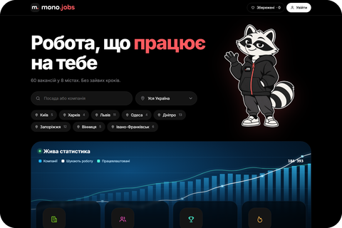
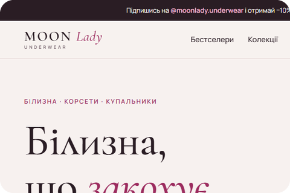
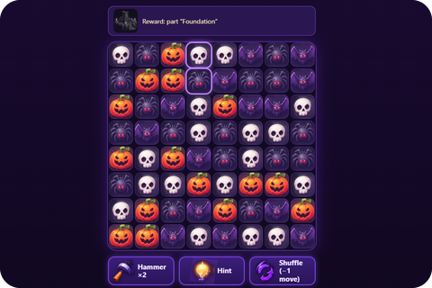
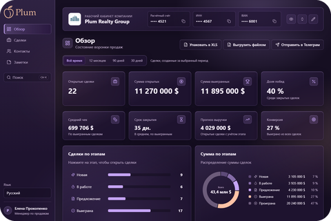

### About me

Front-end developer with 3+ years of experience building responsive web applications with React and Next.js. I love pixel-perfect, mobile-first interfaces.

### Technologies

  &nbsp;&nbsp;
  &nbsp;&nbsp;
  &nbsp;&nbsp;
  

### Styles & UI

  &nbsp;&nbsp;
  &nbsp;&nbsp;
  &nbsp;&nbsp;
  

### Tools

  &nbsp;&nbsp;
  &nbsp;&nbsp;
  &nbsp;&nbsp;
  &nbsp;&nbsp;
  

### AI Tools

  &nbsp;&nbsp;
  &nbsp;&nbsp;
  

### Languages

- **Ukrainian** — native
- **Russian** — native
- **English** — technical, reading documentation

### Skills & Knowledge

| Area | What I work with |
|:---|:---|
| **React / Next.js** | `App Router` `SSR` `SSG` `ISR` `Components` `State management` |
| **Markup & Styling** | `HTML5` `CSS3` `SCSS/SASS` `CSS Modules` `Tailwind CSS` |
| **Responsiveness** | `Responsive` `Adaptive` `Mobile-First` `Cross-browser` |
| **Data** | `REST API` `Async data fetching` `Form validation` `Error handling` |
| **Performance** | `Loading optimization` `Core Web Vitals` |
| **Integrations** | `Third-party APIs` `Webhooks` `Payment widgets` |
| **AI-assisted development** | `Claude Code` `OpenAI Codex` `ChatGPT` `AI-assisted workflow` |

### Projects

<table>
  <tr>
    <td width="190" align="center"></td>
    <td width="30%"><a href="https://github.com/PumpkinDev92/mono-jobs"><b>Monojob (Work Search Concept)</b></a> Solo project · GitHub </td>
    <td>Job board in monobank style</td>
    <td>
      
      
      
    </td>
  </tr>
  <tr>
    <td width="190" align="center"></td>
    <td><a href="https://github.com/PumpkinDev92/moonlady-redesign"><b>Moonlady (Underwear Shop)</b></a> Solo project · GitHub </td>
    <td>Moon Lady Underwear homepage redesign concept</td>
    <td>
      
    </td>
  </tr>
  <tr>
    <td width="190" align="center"></td>
    <td><a href="https://github.com/PumpkinDev92/pumpkin-panic"><b>Pumpkin Panic (Three in a row game)</b></a> Solo project · GitHub </td>
    <td>Halloween match-3 puzzle game for the browser: 30 levels, level map, castle rebuild, EN/RU</td>
    <td>
      
    </td>
  </tr>
  <tr>
    <td width="190" align="center"></td>
    <td><a href="https://github.com/PumpkinDev92/plum-crm"><b>CRM System (Plum)</b></a> Solo project · GitHub </td>
    <td>Compact B2B CRM: deals board with drag-and-drop, contacts, daily notes, analytics dashboard, multi-company workspaces, dark glass UI, UK/RU/EN</td>
    <td>
      
      
      
      
    </td>
  </tr>
</table>
